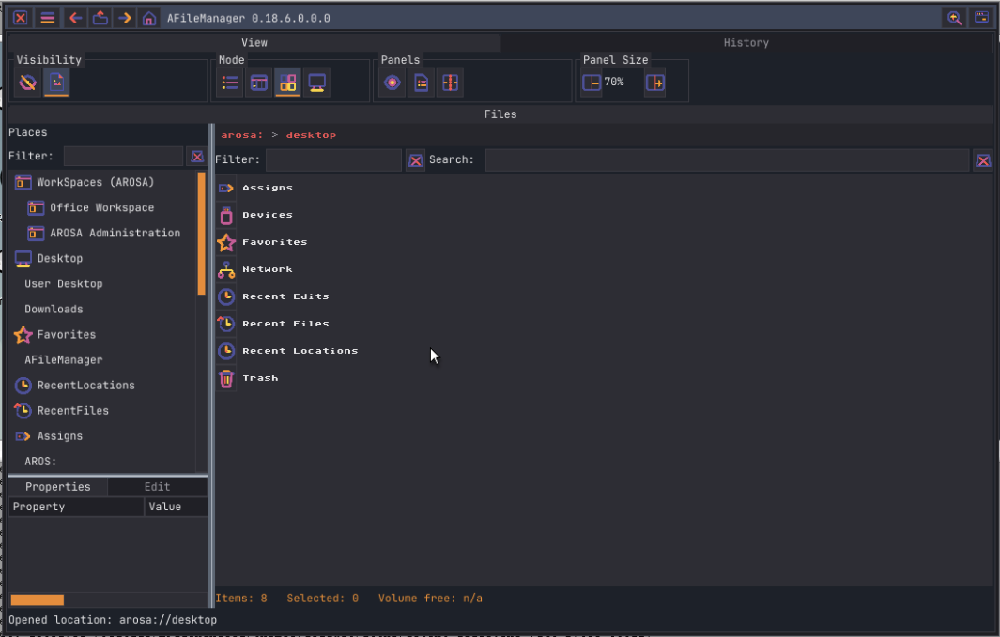

# AFileManager — historical source release

**AROSA**  
*Written for AROS*

This is a prerelease AROSA application source snapshot. The “Enterprise-class architecture at Amiga scale” positioning is reserved for the official AROSA 1.0 release. [Branding policy](https://github.com/danilos/AROSA-Project/blob/main/BRANDING.md).

Historical source baseline: **AROSA 0.18.6.0.0.0**, commit
[`384eeaf25214142aeeb93792fc45ae0858d67d07`](https://github.com/danilos/AROSA/commit/384eeaf25214142aeeb93792fc45ae0858d67d07),
dated **4 November 2026**. The referenced AROSA repository is private; this
standalone source publication does not grant access to or publish it.

Copyright for original AFileManager source and original artwork: **(c) 2026 DaniloS**.
The original AFileManager application source, icons, themes, SVG/PNG artwork,
localization, and included help content are released under the **Mozilla Public
License 2.0** for this historical release. The full license is in `LICENSE`.
Existing individual copyright and license notices are retained. The owner
confirmed authorship and authority to license the original AFileManager artwork.

## Included

- Eleven AFileManager Pascal application units, its window descriptor,
  application help/localization, original artwork and theme files.
- The historical `scripts/build.sh`, retained for source context.
- `LICENSE` and `SHA256SUMS` (checksums for application files).

The following two source files have been given explicit `DaniloS`/MPL-2.0
notices for this release; their implementation content is otherwise unchanged:
`AFileManager.Dialogs.pas`, `AFileManager.Help.pas`. All other selected
application files are preserved from the historical Git commit, except that
`themes/default/source/core/Arosa.Version.pas` was intentionally excluded.

## Important limitations

This publication is an **application source snapshot**, not a complete AROSA
platform SDK or a verified independent build environment. Its build script
refers to additional AROSA build tooling, platform/service units, bindings and
native dependencies which are not in this application-only archive. In other
words, a standalone build is **not claimed**.

The publicly distributed October 2026 preview was labeled
**AFileManager-AROSA-Preview-0.8.6.8.0.2-i386-AROS**. This November 4 source
snapshot is later than that preview. It has **not** been established as the
exact source used to compile that October executable and should not be
presented as such. Any additional MPL-2.0 obligations arising from covered
files incorporated into that earlier executable remain subject to their own
corresponding-source review and fulfillment.

No broader AROSA source tree, private platform implementation, ATransfer
implementation, unrelated applications, internal development specifications,
or build outputs are included. A dependency on a separate AROSA service does
not by itself change that component's licensing status.

This release's MPL-2.0 choice and copyright name do not determine licensing
terms or publication timing for future AFileManager or AROSA releases.

## Screenshots

### AROS x86_64 — AFileManager 0.18.6.0.0.0

SDK-built AFileManager successfully launched and rendered its graphical interface on 64-bit AROS (23 November 2026). This screenshot confirms startup/UI rendering, not all filesystem operations or long-term stability.

